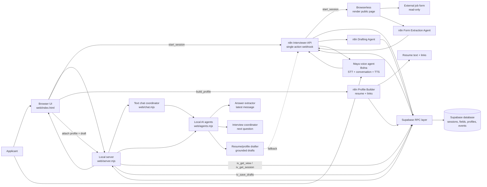
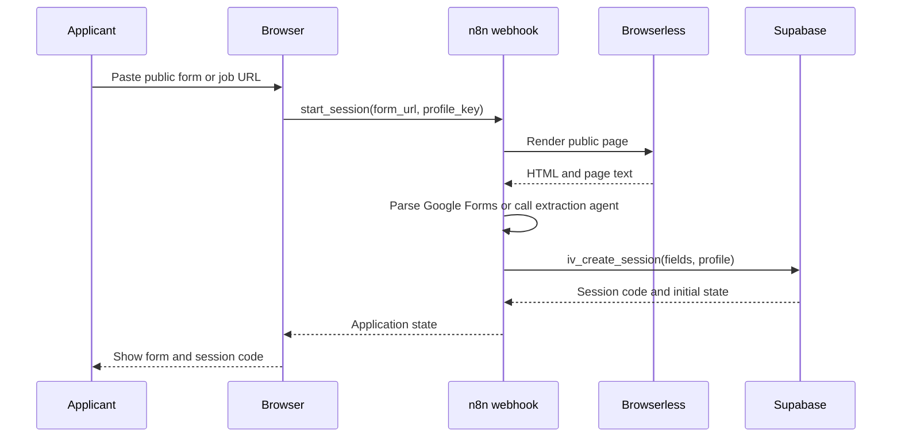
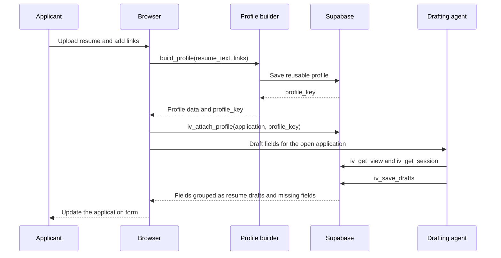
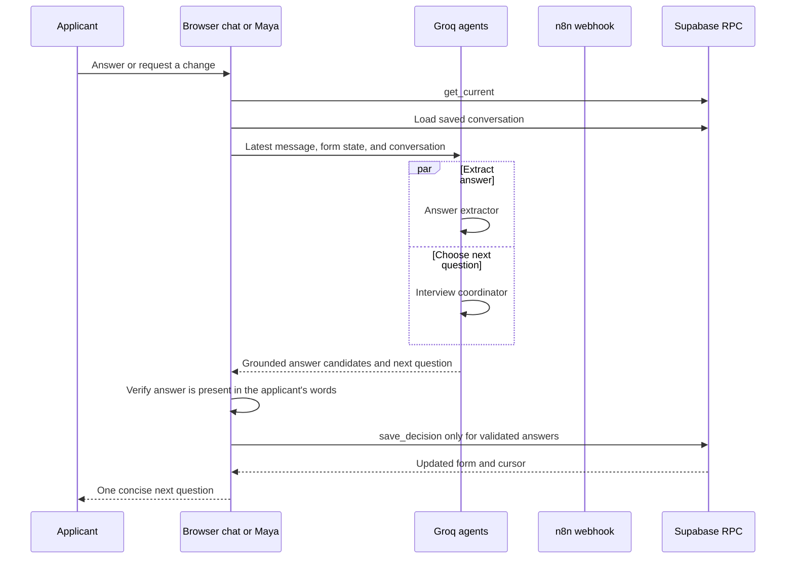
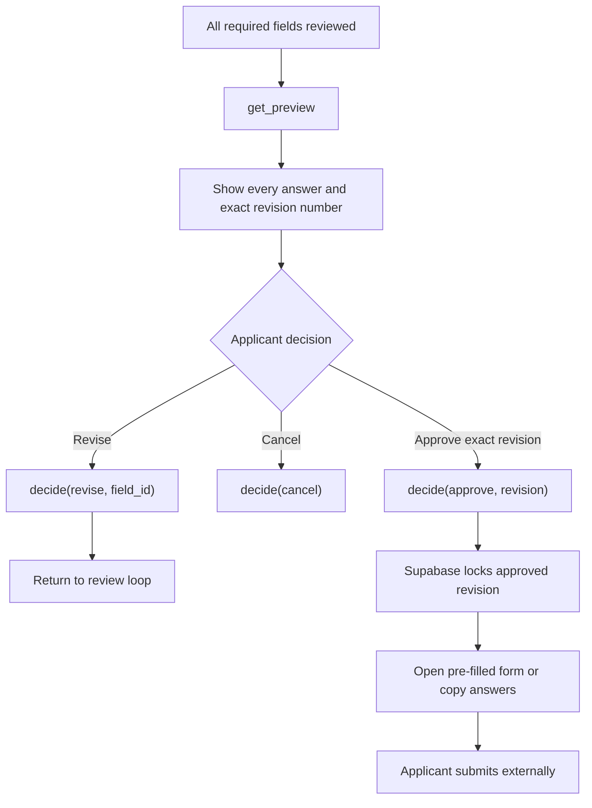
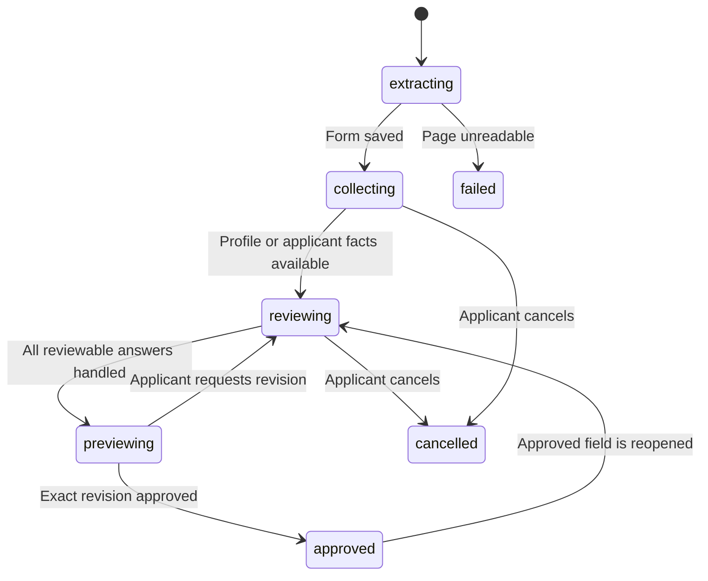

# VoiceAI System Architecture

## Overview

VoiceAI helps an applicant prepare answers for a public job application without
submitting the application automatically.

The system has two user interfaces:

- The browser page, which supports text chat, application forms, profiles, and
  browser-based voice calls.
- The Bolna voice agent, named Maya, which supports the same interview through
  speech.

Supabase is the source of truth for application state. AI agents can suggest
answers, but only validated backend actions save answers or change the
application state.

## Agents and services

| Component            | Type                                   | Responsibility                                                                                                                                    |
| -------------------- | -------------------------------------- | ------------------------------------------------------------------------------------------------------------------------------------------------- |
| Maya                 | Bolna voice agent                      | Converses with the applicant, calls tools, asks one question at a time, and explains the current application state naturally.                     |
| Browser chat agent   | Local Groq agent in `web/agents.mjs` | Extracts answers from the latest text message, chooses the next useful question, and prevents unsupported answers from being saved.               |
| Drafting agent       | Local Groq agent in `web/agents.mjs` | Drafts application fields from the saved resume profile and applicant notes. It checks that drafts are grounded in the source before saving them. |
| n8n extraction agent | n8n OpenAI node                        | Extracts fields from rendered non-Google forms or job postings when the deterministic parser cannot identify the fields.                          |
| n8n drafting agent   | n8n OpenAI node                        | Fallback drafter used when the local Groq drafter is unavailable or disabled. It receives both `applicant_notes` and `resume_profile`.        |
| Profile builder      | n8n `build_profile` workflow         | Converts resume text and supplied links into a reusable profile stored in Supabase.                                                               |
| Form parser          | Browserless plus local/n8n parsers     | Renders a public page and extracts real labels, field types, required flags, and choices.                                                         |
| Supabase RPC layer   | Database functions                     | Enforces cursor rules, validation, revisions, draft saving, approval binding, and event logging.                                                  |

### Agent boundaries

- Maya does not own application state. It calls tools and speaks the result.
- Groq and n8n agents suggest or extract data. They do not bypass Supabase
  validation.
- Supabase RPC functions are the only state mutation boundary.
- The applicant must explicitly confirm, revise, skip, or approve answers.
- The system never submits the external application.

## Complete system diagram



## Main flows

### 1. Open an application



### 2. Build or attach a resume profile



Resume-supported fields such as name, contact information, skills, tools, and
past experience can be drafted from `resume_profile`. Motivation and logistics
fields such as why this role, availability, salary, notice period, and
relocation remain gaps unless the applicant provides them.

### 3. Text or voice interview turn



When Groq is disabled or rate-limited, the local agents use the n8n interview
webhook as a fallback. The n8n path can use its managed OpenAI node.

### 4. Preview and approval



Approval is only accepted for the exact revision shown in the latest preview.
Any answer change invalidates the previous approval. The system never presses
the external Submit button.

## Request routing

The local server exposes the following important routes:

| Route                   | Purpose                                                                              |
| ----------------------- | ------------------------------------------------------------------------------------ |
| `POST /chat`          | Text interview messages through `web/chat.mjs`.                                    |
| `POST /profile`       | Sends resume text and links to the n8n profile builder.                              |
| `POST /draft`         | Drafts fields from the attached profile, using local Groq first and n8n as fallback. |
| `POST /start`         | Starts an application from a pasted public URL through n8n.                          |
| `POST /bolna-session` | Mints a short-lived Bolna web-call session without exposing the Bolna API key.       |
| `POST /voice-turn`    | Processes a voice turn through the local answer extractor and interview coordinator. |
| `POST /form-state`    | Returns the current application state used by the browser form view.                 |

Voice tool calls and browser operations use the n8n webhook:

```json
{
  "action": "get_current | save_profile | draft_answers | save_decision | get_preview | decide",
  "code": "ABC123"
}
```

The n8n workflow routes the action to the corresponding Supabase RPC function.
For `start_session`, it additionally calls Browserless and the extraction
agent. For `draft_answers`, it loads the application view, sends both the
resume profile and applicant notes to the drafting agent, and saves validated
drafts.

## State and trust model



Supabase stores:

- `profiles`: reusable resume-derived profiles.
- `sessions`: application metadata, status, cursor, revision, and profile link.
- `fields`: extracted questions, drafts, evidence, answers, and field status.
- `events`: audit history for profile attachment, drafting, decisions, and
  state changes.
